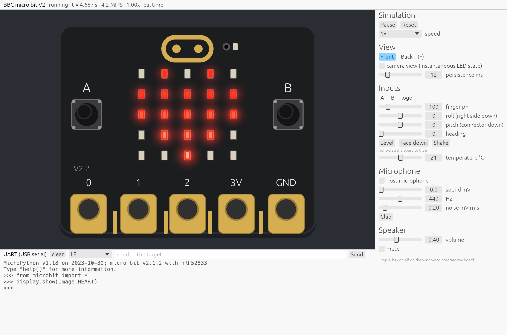

# microbit-v2-sim

[](https://github.com/MatthiasHertelArm/microbit-v2-sim/actions/workflows/ci.yml)

Instruction-set simulator of the BBC micro:bit V2 (Nordic nRF52833, Cortex-M4F) with a GDB server for the
Arm CMSIS Debugger and a GUI that shows the board. Written in Rust for Windows, macOS and Linux.

It simulates the board that the CMSIS-Pack `MicroBit::MicroBit_V2_BSP` describes, so the BSP examples
(Blinky, BoardTest) run unmodified without hardware. MicroPython 2.1 (CODAL) runs too: display, buttons,
touch logo, accelerometer, compass, temperature, microphone and speaker.



<!-- docs/mbsim-window.png, with MicroPython 2.1.2 (see tests/scenarios/micropython.yaml):
     MBSIM_SCREENSHOT=docs/mbsim-window.png:4.5 mbsim micropython-microbit-v2.1.2.hex \
       --send '2:from microbit import *\r' --send '2.8:display.show(Image.HEART)\r' -->

[Getting started](docs/getting-started.md) shows how to use it standalone, with your own firmware or with
MicroPython, and in Keil Studio for VS Code.

[PLAN.md](PLAN.md) has the scope, architecture and fidelity contract; [docs/decisions/](docs/decisions/)
records the decisions taken while building it.

## What is simulated

| Part | Model |
|:--|:--|
| Cortex-M4F r0p1 | ARMv7E-M Thumb-2, DSP, FPv4-SP-D16 with lazy stacking, exceptions and faults, NVIC (48 IRQs, 3 priority bits), SysTick, MPU, DWT (CYCCNT, 4 comparators), FPB (6 + 2), ITM, ROM table. Bit-identical to Arm `FVP_MPS2_Cortex-M4` on the ISA test (174 groups). |
| nRF52833 | CLOCK/POWER, NVMC, FICR/UICR, GPIO P0/P1, GPIOTE, PPI (incl. fixed channels), EGU0–5, TIMER0–4, RTC0–2, UARTE0, TWIM0/1, SAADC (oversampling, scan, internal sample timer, EasyDMA), PWM0–3, TEMP, RNG, WDT, MWU (registers only). Unmodelled registers read as zero and are reported once. |
| Board | 5×5 LED matrix, buttons A/B, capacitive touch logo (RC model), LSM303AGR accelerometer and magnetometer, MEMS microphone with its power pin and LED, speaker, interface MCU (I2C protocol at 0x70/0x72, COMBINED_SENSOR_INT), UART over USB, reset button, edge-connector rings. |

Time is kept in 512 MHz ticks; peripherals are event-driven, so a sleeping core costs nothing. A release build
runs BoardTest at about 90 MIPS, 16× real time.

## Install

[Releases](https://github.com/MatthiasHertelArm/microbit-v2-sim/releases) have one archive per host:
Linux, macOS and Windows, each on x64 and arm64. Each holds `mbsim` (`mbsim.exe`), this README, the
licence and the CMSIS Debugger adapter files in `cmsis/`; `SHA256SUMS` has the checksums.

- The binaries are not signed. On macOS, clear the quarantine attribute after unpacking:
  `xattr -d com.apple.quarantine mbsim`.
- On Linux, the board window needs X11 or Wayland with libxkbcommon, and sound (speaker and host microphone)
  needs libasound2.

## Build

Rust 1.95 or later.

```sh
cargo build --release
# Linux needs the ALSA headers for audio: sudo apt install libasound2-dev
```

The binary is `target/release/mbsim`.

## Run

```sh
mbsim Examples/BoardTest/out/BoardTest/microbit-v2/Debug/BoardTest.elf    # window with the board
mbsim micropython.hex                                                     # .elf, .hex and .bin
mbsim --cbuild-run Examples/BoardTest/out/BoardTest+microbit-v2.cbuild-run.yml
mbsim BoardTest.elf --headless --time 5                                   # UART on stdout
mbsim BoardTest.elf --uart-tcp 4444                                       # UART on a TCP port
```

In the window:

- **A**, **B** and **T** (or the mouse) press the buttons and touch the logo; **Space** presses both
  buttons; **R** resets; **F** flips between the front and the back.
- Right-drag tilts the board; the side panel shakes it and sets heading, temperature, sound at the microphone, finger
  capacitance and the LED persistence of the eye (or the instantaneous "camera" view).
- **host microphone** in the side panel (or `--mic` on the command line) lets the board hear the computer's
  default input device, live: the panel shows its level, and "mV full scale" sets how loud a full-scale host
  sample is at the board's microphone (default 250 mV, a typical MEMS microphone). The sound plays in real time,
  so it needs speed 1x. The first time, the operating system asks for microphone access: on macOS for the app
  that started `mbsim` (Terminal, VS Code), on Windows under Settings › Privacy & security › Microphone ›
  "Let desktop apps access your microphone". Linux records through ALSA (PipeWire and PulseAudio included).
- The UART panel is the USB serial port. Dropping a `.hex` or `.elf` on the window programs the board.
- Hovering over an LED shows its brightness; hovering over ring 0, 1 or 2 shows what the nRF52833 drives on
  the pin.

`mbsim --help` lists all options. `MBSIM_SCREENSHOT=out.png[:seconds]` saves a screenshot and exits;
`MBSIM_GUI_VIEW=back` starts with the back of the board.

## Debug with the CMSIS Debugger

The simulator is a GDB server: `mbsim gdbserver --cbuild-run <file> --port 3333` takes the same options as
`pyocd gdbserver`. It serves the CMSIS Debugger's controlling connection and its auxiliary connection (Live
Watch, CPU Time), a target description with the M-profile system registers and the FPU, a memory map with
flash for `load`, code breakpoints through the FPB, watchpoints through the DWT, and monitor commands.

Three ways to use it in VS Code:

1. **Arm-FVP debug adapter** — no installation. `mbsim` understands the FVP command line, so in the
   csolution:

   ```yaml
   target-types:
     - type: microbit-v2-sim
       board: MicroBit::microbit-v2
       target-set:
         - set:
           debugger:
             name: Arm-FVP
             model: /path/to/mbsim
             args: -C sim.uart_port=4444
           images:
             - project-context: BoardTest.Debug
   ```

   The FVP template turns the auxiliary connection off, so Live Watch stays off in this mode.
   mbsim options are FVP parameters, in `args:` as `-C name=value` or in a `config-file:`, which is
   read like an FVP parameter file (`instance.parameter=value  # comment`). mbsim acts on the last
   part of each name: `disable-visualisation` (no window), `shutdown_on_eot` (exit when the firmware
   sends 0x04, for test runs), `out_file=-` (UART on stdout), `speed`, `uart_port`,
   `semihosting-enable`, `persist`, `mic` (host microphone on). `--simlimit` and `--stat` work as on
   the FVP.
2. **Own debug adapter `microbit-v2-sim`** — `mbsim register-cmsis-adapter` shows where it would install
   [cmsis/microbit-v2-sim.adapter.json](cmsis/microbit-v2-sim.adapter.json) and the `debug-adapters.yml`
   entry; `--apply --backup-dir DIR` installs them. Then `debugger: name: microbit-v2-sim`.
3. **Hand-written `launch.json`** — [cmsis/launch.example.json](cmsis/launch.example.json), with
   `"updateConfiguration": "manual"` so CMSIS Solution leaves it alone.

`monitor help` lists the monitor commands: `reset [halt|run]`, `halt`, and `sim …` to press buttons, touch,
tilt, set heading, temperature and sound, send UART text, read the LED matrix and the model warnings.

## Scenarios

A scenario drives inputs and checks outputs in simulated time, so it gives the same result on every host:

```yaml
- at: 1.3
  expect-leds: ["00000", "00000", "00100", "00000", "00000"]
- at: 1.4
  tilt: [40, 0]               # roll, pitch in degrees
- at: 1.8
  press: A
- at: 2.35
  expect-tone: 440
- at: 2.7
  uart: "t"
- at: 3.2
  expect-uart: "tone 880 Hz"
```

Steps: `press`, `release`, `touch`, `tilt`, `heading`, `temperature`, `sound: [mV, Hz]`, `clap`, `uart`,
`reset`, `expect-uart`, `expect-leds`, `expect-tone`, `exit`. Run with
`mbsim image --headless --speed max --scenario file.yaml`; the exit code is 1 when an expectation fails.
[tests/scenarios/boardtest.yaml](tests/scenarios/boardtest.yaml) covers every peripheral BoardTest uses;
[tests/scenarios/micropython.yaml](tests/scenarios/micropython.yaml) drives the MicroPython REPL (the file
says where to get the firmware).

## Tests

CI ([.github/workflows/ci.yml](.github/workflows/ci.yml)) checks formatting and clippy, then builds for
all six hosts and tests and runs the BoardTest and MicroPython scenarios on the five that run natively
(macOS x64 is cross-built on arm64). A tag `v*` publishes a release
with the archives.

```sh
cargo test --workspace --release
mbsim fixtures/elf/BoardTest.elf --headless --speed max --scenario tests/scenarios/boardtest.yaml
```

- `mbsim-cpu`: decoder, ALU and FPU unit tests.
- `mbsim-microbit/tests/reference.rs`: runs [firmware/isa-test](firmware/isa-test) and compares every result
  with the output of Arm `FVP_MPS2_Cortex-M4` recorded in
  [fixtures/isa_test.fvp.txt](fixtures/isa_test.fvp.txt); runs BoardTest and checks its report.
- `mbsim-gdb/tests/rsp.rs`: a controlling and an auxiliary GDB connection against a running target.

`firmware/isa-test/build.sh` rebuilds the ISA test with the Arm GNU Toolchain.

## Layout

| Crate | Content |
|:--|:--|
| `mbsim-core` | time base, event scheduler |
| `mbsim-cpu` | Cortex-M4F: decoder, executor, FPU, system control space |
| `mbsim-nrf52833` | memory, bus and peripherals of the nRF52833 |
| `mbsim-microbit` | board: LEDs, buttons, touch, LSM303AGR, microphone, speaker, interface MCU; machine and simulation thread |
| `mbsim-loader` | ELF, Intel HEX, binary, `*.cbuild-run.yml` |
| `mbsim-gdb` | GDB remote serial protocol server |
| `mbsim-gui` | window: board artwork, LED optics, inputs, audio |
| `mbsim` | command line, scenarios, UART bridges, control port |

## Not simulated (yet)

Radio and Bluetooth, USB of the nRF52833, SPIM/SPIS, UARTE1, I2S, PDM, QDEC, COMP/LPCOMP, NFC, ECB/CCM/AAR,
the battery connector, and edge-connector devices. Timing of flash wait states and the instruction cache is
approximate. The behaviour that needs a measurement on a real board (FICR contents, SysTick CALIB, touch
counts, LED brightness) is listed in PLAN.md under the first steps.

"micro:bit" is a trademark of the Micro:bit Educational Foundation; this project is not affiliated with it.
